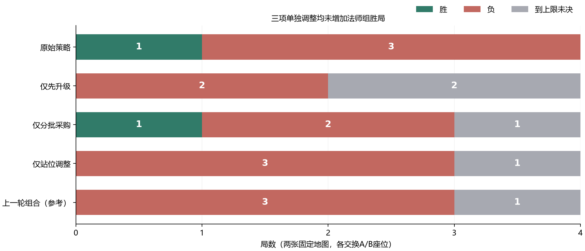
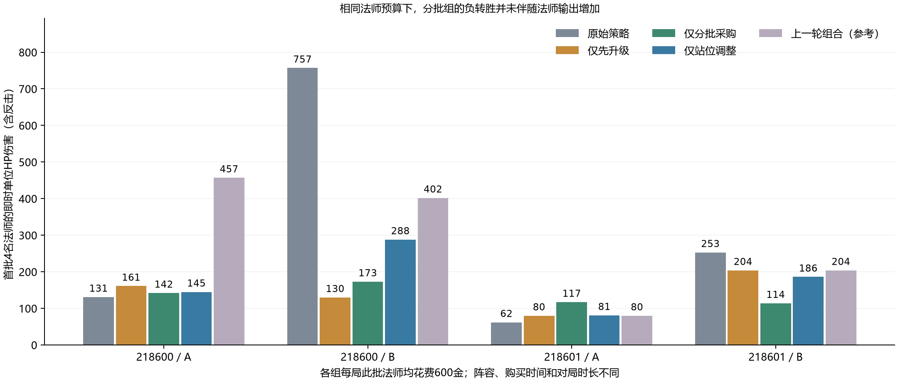

# 法师拆分对测：三项单独调整均未增加胜局

三组各4局已完成：先升级0胜2负2未决，分批采购1胜2负1未决，站位调整0胜3负1未决；原始策略为1胜3负。**先升级改变了发展节奏，分批采购改变了获胜座位，站位偏置减少了局部暴露，但没有哪一项单独增加胜局。** 当前不把三项单独策略认定为已验证的普适强化，继续保留在实验分支。

本轮没有修改兵种数值、价格、技能或评分。新增的是可选实验辅助函数、15项定向测试和冻结控制器；现有默认AI入口未再改动。[完整对比](mage-ablation-20261109/comparison.json)保留逐局数据、首个动作分歧和阵容输出，便于检验以下结论。

| 策略 | 4局结果 | 首次升四代回合 | 招满首批4名回合 | 首批16名单位HP伤害 |
|---|---|---|---|---:|
| 原始策略 | 1胜3负 | 25、24、未达、未达 | 3、4、3、4 | 1203 |
| 仅先升级 | 0胜2负2未决 | 1、2、1、2 | 9、10、9、10 | 575 |
| 仅分批采购 | 1胜2负1未决 | 29、24、73、126 | 7、8、7、8 | 546 |
| 仅站位调整 | 0胜3负1未决 | 21、24、未达、未达 | 3、4、3、4 | 700 |
| 上一轮组合（参考） | 0胜3负1未决 | 1、2、1、2 | 9、10、9、10 | 1143 |

两列回合均按218600/A、218600/B、218601/A、218601/B排列，使用单方行动回合计数。“未达”是未升到四代；“未决”是达到200单方回合上限而没有原生赢家，不计平局、半胜或败局。每组首批16名法师均花费2400金。

## 三组究竟拆了什么

| 新组 | 唯一启用组件 | 保持原始策略的部分 |
|---|---|---|
| 先升级 | 第一名法师前，金币同时够原价升级和1名法师、且可见敌军未迫近时，先付540金升四代 | 原首批4名采购、原AI采购评分、原走位及其他兵种逻辑 |
| 分批采购 | 首批4名每己方回合最多买1名；目标未完成且仍合法时，普通招募/建造/升级须留出下一名法师的金币 | 不强制先升级、不补护卫、不加普通法师比例限制，走位和其他兵种逻辑原样 |
| 站位调整 | 只把上一轮法师的护卫接近、射击机会和暴露风险偏置加入移动与原地候选 | 原首批4名采购、原升级与普通采购、其他兵种逻辑 |

“分批”本轮是频率限制与预留150金组成的采购组件，没有再拆这两个操作。三组都与最初AI比较，不是在上一轮组合策略上随意关掉一项。上一轮组合还含普通采购混编过滤和骑士长逻辑，因此其4局只作背景参考；本实验不估计三项在组合中的贡献比例或交互项。

## 先升级：跨过门槛，同时压缩了早期出兵资金

四局都在第1/2回合升到四代，代替原来的25、24、未达、未达。但首批4名直到第9/10回合才买齐，原先是第3/4回合。以218600/A为例，首回合709金先支付540金升级，剩169金，买1名150金法师后只剩19金；后续收入继续用于补齐法师。它没有显式开启分批限制，却因同一预算竞争自然变慢。

因此，这组测量的是**先升级优先级在原采购约束下的完整影响**，并非固定出兵时点之后的纯科技收益。测试仍要求买齐4名法师；升级解锁的其他选择要受剩余现金和原采购规则约束，不能把“已升级”直接等同于“已形成四代战力”。

218600/A由胜变为未决，218600/B由负变为未决，另外两局仍负；没有新增胜局。首批相同2400金的单位HP输出1203→575，5名法师阵亡前没有主动开火。首回合升级确实修正了原来的科技延误，但这个事实不足以证明它更适合当前法师首批目标。

## 分批采购：换了获胜座位，没有净增胜局

本组首批采购时点为A座1、3、5、7回合，B座2、4、6、8回合；没有触发先升级规则。四局首次升四代为29、24、73、126，说明“少买一名、留150金”本身不会自动变成早升级。正常收入、其他购买和后续交战继续决定发展路线。

逐局变化不能只写成“仍有1胜”：218600/A从胜变负，218600/B从负变胜，218601/A从负变未决，218601/B仍负。新胜局的法师即时HP输出为173，原同座失败局却有757。新局该方全军即时单位HP输出2851，其中恶魔1056、榴弹炮366，法师约占6.1%；原局全军1882。它体现了采购改变后的整支阵容轨迹，不能解释为法师单兵输出变强，也不能把恶魔输出当成单独导致胜利的证明。

固定首批16名的输出1203→546；全局法师招募支出2850→2550金、输出1260→597。减少后续购买解释不了全部输出下降，因为同预算首批也下降。现有证据支持“分批能显著改写战局”，不支持“分批稳定提升法师胜率”。

## 站位调整：局部风险改善没有转化成更多胜局

本组首批购买时点与原版完全相同，均在第3/4回合买齐。首次动作分歧出现在第3/4回合，涉及法师移动候选的选取或优先级；例如218600/B原AI在第4回合结束行动，新AI继续移动法师。采购和升级代码没有新增规则，之后的资金、升级时刻变化属于站位改变后的连锁结果。

固定可见敌军位置的检查中，“从没有单发致死威胁移入这类威胁”的法师动作由原2次降至0次；然而原来的2次也没有被对应已知威胁在下一回合杀死。这个局部指标不包含敌军移动、集火或迷雾单位，不能据此宣称死亡问题已解决。

四局变为0胜3负1未决，原唯一胜局变未决；首批输出1203→700，首批16名仍全部阵亡。全局18名付费法师中17名阵亡，15名死于暗夜死灵法师；11次是在满24HP时被攻击击杀。三组与原版在己方回合结束时都没有遗漏可见、合法、正伤害的战斗单位/城池攻击；剩余可攻击目标均为桥。现有站位偏置单独不足以把法师的脆弱性转化为有效战力。

## 相同法师预算与逐局结果

首批输出的下降主要集中在218600/B：原757，先升级130、分批173、站位288；其他三格的变化较小且方向不一。不能把受单局影响很大的4局总量外推成所有地图的普遍效率。三组各自首批16名均全部阵亡，与原策略相同，兵种24HP及现有反制关系没有变化。

| 策略 | 全局付费数量 | 支出（金） | 单位HP伤害 | 主动攻击次数 | 零主动攻击后死亡数 | 每100金HP伤害 |
|---|---:|---:|---:|---:|---:|---:|
| 原始策略 | 19 | 2850 | 1260 | 70 | 3 | 44.2 |
| 仅先升级 | 16 | 2400 | 575 | 27 | 5 | 24.0 |
| 仅分批采购 | 17 | 2550 | 597 | 29 | 3 | 23.4 |
| 仅站位调整 | 18 | 2700 | 775 | 35 | 4 | 28.7 |
| 上一轮组合（参考） | 16 | 2400 | 1143 | 50 | 2 | 47.6 |

全局指标包含首批以后按普通AI购买的法师；即时伤害包含主动攻击和反击，治疗后的重复受伤可能再次计入，不代表独立击杀血量或胜率。分批组另有17城池HP伤害，其他组为0。不同对局时长和后续阵容会影响累计输出，故并列展示同预算首批结果。

| 地图/座位 | 原始 | 先升级 | 分批采购 | 站位调整 | 上轮组合（参考） |
|---|---|---|---|---|---|
| 218600 / A | 胜（127） | 上限未决（200） | 负（104） | 上限未决（200） | 上限未决（200） |
| 218600 / B | 负（131） | 上限未决（200） | 胜（168） | 负（155） | 负（117） |
| 218601 / A | 负（86） | 负（100） | 上限未决（200） | 负（96） | 负（128） |
| 218601 / B | 负（77） | 负（77） | 负（177） | 负（65） | 负（77） |

括号为消耗的单方回合。结论是这三项启发式都还没有通过增胜验证；它们改变了不同中间环节，不能把原评分与实战的差异仅归结为AI不肯攻击或采购太集中。本轮继续保留兵种数值和评分，未将实验策略替换成新的默认配置。

## 环境、源码隔离与复核

沿用20×20随机公平地图，种子218600/218601、A/B换座；双人各两座2×2城，第三时代开局、基础金币600与正常收入，战争迷雾开启，基础兵种加原测`fantasy`和`pack-contemporary`，高级AI每己方回合最多2招募、1升级、50次决策，原AI编制限制24，200单方回合上限；选卡、指挥官、上帝模式关闭。本轮全部是法师三代自然开局，没有英雄四代开发前缀。

实际冻结局面版本v4、原生回放格式v3，采用与原测一致的核心指纹`221136b94476994ea3deb49b9c888c35c8d3ddf252e923f31711db49e58b3414`。测试方只使用选定单组件，对手始终为原AI。12对起始状态、配置与开发动作前缀哈希一致。策略、种子和适配器在首局结果前封存，此后未调参或换图，详见[协议](mage-ablation-20261109/protocol.json)、[封存清单](mage-ablation-20261109/seal.json)和[源码隔离检查](mage-ablation-20261109/isolation-validation.json)。

先升级组的AI文件与原版逐字节一致，改动只在首批采购控制器；分批组只加入候选过滤入口；站位组只加入法师移动/原地评分入口。所有补丁逆向恢复后与原AI及原对局统计脚本完全一致。69个原核心文件中，除了上述AI入口，规则、兵种、经济、迷雾文件均保持原哈希。

本轮12局全部原生重放核对了赢家、回合、最终金币、采购与伤害；非法动作和预算违规均为0，首批目标全部完成。干净发布源码通过类型检查、15项新测试、12项前轮策略测试、51项AI测试、7项评测测试、580项规则测试、9项回放测试和构建；三组冻结控制器另通过类型检查，见[检查摘要](mage-ablation-20261109/checks.json)。

两张图换座构成配对，不是4张独立地图；本轮也不是完整析因实验。旧4局原始与4局组合仅复用原记录，不冒充新样本。局部站位探针属于机制诊断，不增加胜负样本数。

## 获取代码与回放

[新增源码补丁](mage-ablation-20261109/experiment.patch) · [三组入口差异](mage-ablation-20261109/source-deltas.json) · [复现说明](mage-ablation-20261109/REPRODUCE.md) · [完整20局原生回放与复现包](mage-ablation-20261109/reproduction.zip) · [文件清单](mage-ablation-20261109/artifact-manifest.json)。新增实验函数位于[ai-mage-experiment.ts](../src/core/ai-mage-experiment.ts)，新增测试位于[test-ai-mage-experiment.ts](../scripts/test-ai-mage-experiment.ts)。

实验分支以[上一轮冻结候选提交](https://github.com/wanderingmoonn/grid-warchess/commit/ddd177d15df4edf7d34a326b2855d3549c084a28)为父提交，保留既有文件和历史报告；对测控制器仍明确以最初AI为基线。源码新增2个文件，未再次改动默认AI或兵种定义，也未覆盖main。[上一轮完整分析](https://github.com/wanderingmoonn/grid-warchess/blob/ddd177d15df4edf7d34a326b2855d3549c084a28/docs/UNIT-STRATEGY-RETEST-2026-11-08.md)保留原结论。
