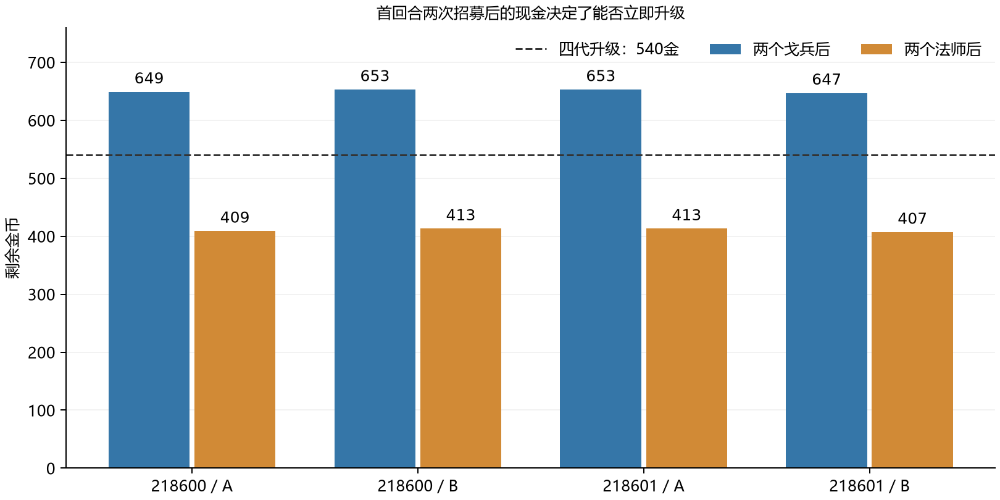
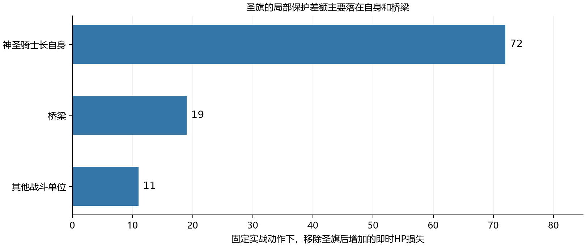

# 法师 神圣骑士长和戈兵的评分与实战差异复核

复核日期：2026-11-08，Asia/Shanghai。原评分与兵种数值均保持不变。

本次重新检查了三个兵种的12局实战和4局同阶段基线，并用冻结规则做逐动作局部重算，没有新增完整AI对局。结论是：**法师与戈兵的采购成本触发了不同的首轮升级路径；神圣骑士长同时受到攒钱空窗、技能时序和低机动的限制。现有结果不足以把胜局差直接归因于兵种面板。**

- **法师**：AI实际执行70次攻击。可以确认的主要限制是采购占款和24血的生存能力；“AI不会攻击”缺少回放支持。
- **神圣骑士长**：四局都在正式交战阶段先攒4个己方行动回合，才买到首个690金英雄。45次圣旗中，有18次存在经过规则验证的、覆盖更多战斗友军的先移动后施放方案。
- **戈兵**：30金的价格让四组配对都能在第一轮升四代。已追踪购买体只贡献160点即时兵伤、0城伤；3胜1负主要支持这套便宜采购方案，并未证实其单体战力应该高于法师。

[逐局数据和定义](unit-mismatch-review-20261108/review-summary.json) · [完整复现包](unit-mismatch-review-20261108/reproduction.zip) · [冻结代码摘录](unit-mismatch-review-20261108/code-evidence.txt)

## 比较口径

| 兵种 | 原分 | 胜／负／未决 | 初始优先采购 | 四局已追踪购买体 | 实际招募支出 | 即时兵伤 | 城伤 |
|---|---:|---:|---:|---:|---:|---:|---:|
| 戈兵 | 5.5 | 3／1／0 | 每局4个，共120金 | 17个 | 510金 | 160 | 0 |
| 法师 | 8 | 1／3／0 | 每局4个，共600金 | 19个 | 2850金 | 1260 | 0 |
| 神圣骑士长 | 8.5 | 0／3／1 | 每局1个，首次690金 | 6个 | 3700金 | 161 | 120 |

“已追踪购买体”包含后续AI正常购买的同类单位；复活和其他途径生成的单位不自动并入这一集合。即时兵伤计主动攻击、技能和受击反击时的敌方HP损失。辅助增益另行计算，不能用神圣骑士长的161点兵伤代替它的全部价值。未决表示达到200个单方行动回合上限后仍无胜者。

地图种子为218600和218601，每张图受测方分别使用A、B座位。共同环境为20×20、双方各两座2×2城市、第三时代开局、基础金币600并按原规则结算收入、开启迷雾、启用奇想与信息时代扩展、高级AI、每方每回合2招募／1升级／50次决策。战斗包优先采购完成后恢复正常混编采购。神圣骑士长是四代兵种，使用双方合法支付的共同发展前缀；前缀占用回合上限。

样本采用固定数量初始包，**没有同时控制初期支出、单位数量和后续AI采购**。因此本轮可以解释采购方案如何与AI发生作用，不能把结果当作等预算单兵决斗。每种只有两个地图块。

## 法师与戈兵在首回合就走上了不同的科技路径

四组同种子、同座位配对的第一轮可用现金为707–713金。初始包前两个戈兵合计60金，前两个法师合计300金。四代升级价格为540金：

| 种子／座位 | 首轮可用现金 | 两个戈兵后 | 两个法师后 | 戈兵方首次四代 | 法师方首次四代 |
|---|---:|---:|---:|---|---|
| 218600／A | 709 | 649 | 409 | 第1回合 | 第25回合 |
| 218600／B | 713 | 653 | 413 | 第2回合 | 第24回合 |
| 218601／A | 713 | 653 | 413 | 第1回合 | 败局结束前未升级 |
| 218601／B | 707 | 647 | 407 | 第2回合 | 败局结束前未升级 |

回合数均为单方行动回合，A的首轮是1，B的首轮是2。买满当轮两个单位后，测试采购适配器允许AI使用当轮升级名额：戈兵方仍够付540金，并在四局全部立即升级；法师方的余额不足。**这里已证实的是现金门槛改变了首轮升级的可行性。**

四个初始单位的总差额进一步扩大到480金。法师方之后还要在补兵、经济、英雄和升级之间分配现金。不能把这480金简单换算成固定的升级延迟：例如218600／A中，戈兵方六代反而比法师方更晚。后续局势和采购路径已经分叉。

早升四代也不保证赢：218601／B的戈兵方仍然失利，218600／A的法师方晚升仍然获胜。预算门槛是已确认的机制，不能作为整局胜负的充分解释。

### 法师确实开火 但容易在一次攻击动作内阵亡

19个已购法师共开火70次，累计1260点即时兵伤。按同口径除以实际招募支出，法师为0.442 HP／金，戈兵为0.314 HP／金。这个描述性比值没有控制出场时间、目标和队形，不能作为统一的性价比分数；它至少不支持“法师连直接输出都不如戈兵”的解释。

19个法师全部阵亡：14个死于暗夜死灵法师的攻击动作，5个死于不死鸟的攻击动作。15个在死亡动作开始前仍有完整24血。法师的脆弱性在样本中实际发生，并非只由面板推测。

冻结规则的平地探针也显示这种对局限制：在3格距离，法师可以对暗夜死灵法师造成19点，后者可以反打31点；法师只有24血。对超级重骑的同距离攻击则为18点，超级重骑无法还击。这说明原评分提到的远程反重甲用途仍然存在，但本组主要致死对手并非该类笨重近战。

AI使用方面，回合结束时只发现2条有伤害但未使用的法师攻击机会，目标均为桥梁；没有发现未使用的正伤害战斗单位目标或攻城机会。对全部87次法师移动的保守探针发现2次从“无已见静止敌军单发致死威胁”的格子进入有此威胁的格子，其中1次有合法的较安全开火替代；这2次都没有被所识别敌军在紧接着的对方回合击杀。**这些局部机会不足以把19例死亡主要归因于已证实的AI前压错误。**探针不覆盖敌军移动、集火或迷雾外威胁。

法师在218600／B一局造成757点兵伤，却仍然失利。这也表明，输出是否兑现与队伍最终是否取胜需要分别判断。

## 神圣骑士长的采购空窗与圣旗覆盖都值得先复测

四代共同发展前缀结束后，优先采购策略为690金首招攒钱。四局都在正式测试阶段等待4个己方行动回合，首个英雄到第11／12回合才购入。此时的“无招募空窗”来自本次采购约束，不能解释成AI在一般对局中必然做出的决定。

| 种子／座位 | 结果 | 首次招募回合 | 正式阶段攒钱回合 | 圣旗次数 | 局部保护差额 |
|---|---|---:|---:|---:|---:|
| 218600／A | 负 | 11 | 4 | 19 | 84 HP |
| 218600／B | 未决 | 12 | 4 | 19 | 18 HP |
| 218601／A | 负 | 11 | 4 | 2 | 0 HP |
| 218601／B | 负 | 12 | 4 | 5 | 0 HP |

圣旗正常生效：半径2内友军获得护甲+3、魔抗+4和溅射免疫，持续至自己的下个回合开始。施放不消耗移动或普通攻击。探针中，同一火枪兵受到暗夜死灵法师的平地伤害由29降到22，受到法师的伤害由22降到15。没有发现圣旗“数值写了但没生效”的问题。

### AI会开圣旗 但开的位置与顺序影响覆盖

45次圣旗中37次发生在施法者移动前。冻结AI给英雄技能候选额外加300分；圣旗触发条件统计附近全部己方单位，包含经济单位和建筑，没有先按战斗伙伴覆盖质量选择移动位置。

逐一检查45个真实施法前状态，18次存在合法的“先移动、再圣旗”方案，能覆盖更多其他战斗友军，且不增加探针所定义的可见静止敌军每发伤害总和。这里的威胁指标不包含敌军移动、多发攻击和集火，不能称为完整安全证明。

一个可复查的例子是`holy-knight-lord-218600-B`第54回合、动作索引298：施法者在(8,12)，当场覆盖2个其他战斗单位；先移到(10,12)再施放，可以覆盖5个，两处的上述可见威胁指标均为0。两步操作已经由冻结规则验证合法。坐标和动作索引均从0计。这个例子属于全部18次机会之一，未声称能改变该局胜负。

另有5次施放没有覆盖施法者以外的战斗单位；这些施放覆盖了经济单位。由于圣旗不占普通行动，不能仅凭这种覆盖就把施放本身认定为负收益；它提示AI的触发条件与团队防护目标存在距离。

### 施放次数不能直接当作团队保护收益

对每个有圣旗增益的实战动作，保留原动作，仅在影子状态中去除己方圣旗，再用同一规则重算。逐动作即时HP损失差额合计102点：自身72、桥梁19、其他战斗单位11。45次施放中18次有正的、可归属到该次施放的局部保护差额。

**102点是固定动作下局部重算差额的合计，不是无圣旗整局会多损失的生命。**每次重算都会恢复真实前态；没有让死亡、后续选目标、移动和AI策略沿无增益分支发展，因此也不能据此计算圣旗对胜率的贡献。

兵种自身仍有明确使用条件：移2、射程1，不能在普通相邻格攻击空中的不死鸟。它的150血、14甲和圣旗适合有可保护队友的阵线；本组6个购买体只有8次主动攻击，161兵伤、120城伤，支持价值又没有持续覆盖到主要战斗伙伴。当前采购与AI队形尚未让原8.5分假设的团队收益充分兑现。

## 戈兵的胜局体现了便宜采购的作用 单体输出仍有限

17个已购戈兵共13次主动攻击，126点主动兵伤、34点反击兵伤、0城伤。相同归因口径下，受测方四局总即时兵伤为8874点，已追踪戈兵只占1.8%。该口径不含自动塔火和后续毒烧伤害。

在218600／A胜局，4个已购戈兵一次主动攻击和攻城都没有，只造成18点反击伤害。该局恶魔贡献1260点即时兵伤及224点城伤；218600／B胜局的主要即时输出包括恶魔1123点、榴弹炮966点；218601／A胜局则包括暗夜死灵法师449点、步枪兵419点。这些是“队伍赢了”与“戈兵直接打赢了”的可观察区别。

戈兵累计承受445点HP损失，30金的低价也有便宜占位、承伤的实际用途；但不能把这些承伤全部解释成替昂贵队友挡下的伤害，因为回放没有提供敌人面对另一套队形会如何选目标的反事实。

平地机制探针中，戈兵在1格对暗夜死灵法师造成11点，承受31点；在3格无法攻击，对方仍可攻击。对相邻空中不死鸟也无法正常出手。原5.5分所依据的短射程与对空限制没有被3胜1负推翻。

## 维持数值 优先验证采购与使用方式

| 归因维度 | 法师 | 神圣骑士长 | 戈兵 |
|---|---|---|---|
| AI使用 | 已执行70次攻击；少量局部站位机会不足以解释全部死亡 | 有18次经过规则验证的覆盖改进机会，技能排序与队形是具体复测目标 | 首局大量移动但无主动输出；没有证据说明AI把戈兵发挥成高强度主力 |
| 采购成本 | 首轮两个单位占300金，阻断当轮540金升级；四个包比戈兵多占480金 | 690金首招导致正式阶段4个己方回合不招兵 | 两个单位仅60金，四局均保留第一轮升四代的现金 |
| 兵种自身 | 24血、面对样本中的高伤害对手容易在一次攻击结算中阵亡；反重甲远程能力仍存在 | 移2射1、依赖队友在半径2内，护甲和技能均按规则生效 | 单价低但射程短、对空受限，直接输出和攻城记录没有显示高分主力水平 |
| 当前判断 | 复测较小法师包及混编保护后，再判断原8分 | 复测减少裸攒空窗、先走位再施法的策略后，再判断原8.5分 | 保留“低价采购方案有效”的发现，暂不据胜局把5.5分上调 |

这些原因可以同时成立。本次没有足够独立地图和完整策略对照，不能给出“AI占几成、成本占几成、面板占几成”的百分比分解。

## 证据与复现

- 冻结基础提交：`a7978c16d5fb2ea22d258dcb6570f4bfb90e0fbd`，另含当时已有的工作区改动。核心文件集合指纹为`221136b94476994ea3deb49b9c888c35c8d3ddf252e923f31711db49e58b3414`。适用版本是复现包中的冻结引擎，不能直接把结论当作当前`main`的验证。
- 12局受测样本与4局同阶段控制的动作序列均重新重放，动作哈希、胜者、回合和双方最终金币一致；三个受测兵种的即时伤害与原基准统计一致。16局的规则拒绝尝试均为0。
- 复现包包含冻结引擎、16份原生回放及结果、原协议、三个兵种的原评分、逐动作统计、局部探针、绘图脚本和文件哈希清单。脚本只读游戏配置，分析结果另写；没有修改兵种定义或保存的实战动作。
- 完整脚本与命令见[复现说明](unit-mismatch-review-20261108/README.md)。原生回放中的`at`为原实验固定展示日期，不代表实际执行时间。

### 各兵种四局概览

| 兵种 | 种子／座位 | 结果 | 已购数量 | 主动攻击 | 即时兵伤 | 城伤 |
|---|---|---|---:|---:|---:|---:|
| 法师 | 218600／A | 胜 | 4 | 4 | 131 | 0 |
| 法师 | 218600／B | 负 | 4 | 43 | 757 | 0 |
| 法师 | 218601／A | 负 | 6 | 5 | 95 | 0 |
| 法师 | 218601／B | 负 | 5 | 18 | 277 | 0 |
| 戈兵 | 218600／A | 胜 | 4 | 0 | 18 | 0 |
| 戈兵 | 218600／B | 胜 | 4 | 1 | 12 | 0 |
| 戈兵 | 218601／A | 胜 | 5 | 9 | 90 | 0 |
| 戈兵 | 218601／B | 负 | 4 | 3 | 40 | 0 |
| 神圣骑士长 | 218600／A | 负 | 2 | 2 | 48 | 0 |
| 神圣骑士长 | 218600／B | 未决 | 2 | 0 | 0 | 0 |
| 神圣骑士长 | 218601／A | 负 | 1 | 5 | 87 | 0 |
| 神圣骑士长 | 218601／B | 负 | 1 | 1 | 26 | 120 |
