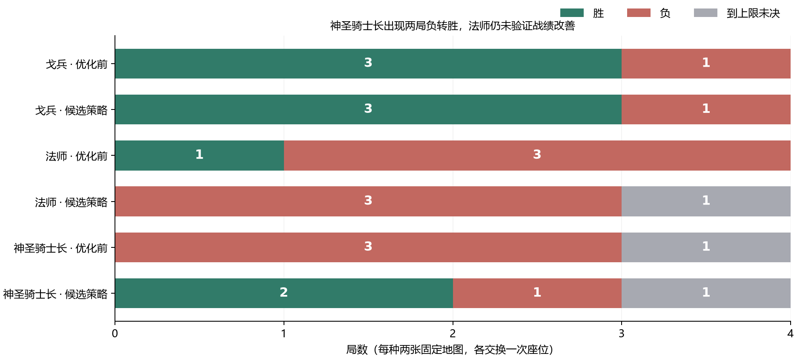
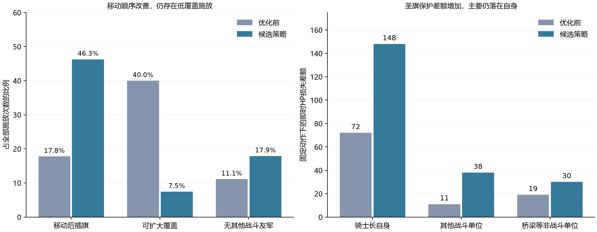

# 神圣骑士长的使用得到改善，法师采购调整仍未通过战绩验证

本轮已实现并封存采购与使用策略，完成三种兵种各4局、共12局复测。神圣骑士长在两张固定地图上都出现A座由负转胜；法师的升级节奏改善，但原来唯一获胜的一局变为到上限未决；戈兵四局连同行动序列均与原测一致。**神圣骑士长策略有继续验证的价值；法师整套调整不能据此认定成功，保留为实验候选。**

兵种数值、价格、技能、招募解锁和战斗规则均未更改；原评分也未改动。此次上传包含实际AI代码、定向测试、逐局结果和可复核的原生回放。证据见[完整对比](unit-strategy-20261108/comparison.json)和[一致性检查](unit-strategy-20261108/comparison-validation.json)。

| 兵种 | 优化前 | 候选策略 | 全局付费数量 | 兵种招募支出（金） | 即时单位HP伤害 |
|---|---|---|---:|---:|---:|
| 戈兵 | 3胜1负 | 3胜1负 | 17 → 17 | 510 → 510 | 160 → 160 |
| 法师 | 1胜3负 | 0胜3负1未决 | 19 → 16 | 2850 → 2400 | 1260 → 1143 |
| 神圣骑士长 | 0胜3负1未决 | 2胜1负1未决 | 6 → 6 | 3700 → 3700 | 161 → 292 |

数量、支出、伤害均为对应兵种在4局中的合计，包含完成初始招募目标后的普通招募；伤害包括主动攻击与反击，另计城池伤害。上限未决表示200个单方行动回合内原生裁决尚未产生赢家，未折算成平局、半胜或败局。

## 实际改动

[ai-unit-strategy.ts](../src/core/ai-unit-strategy.ts)集中实现以下策略，并由[ai.ts](../src/core/ai.ts)接入高级AI。[AiBudget](../src/core/ai-meta.ts)增加可选的采购目标，不增加持久游戏状态或新动作。

| 对象 | 采购策略 | 使用策略 |
|---|---|---|
| 法师 | 目标为4名时分批招募，每己方回合至多1名；第一笔资金同时够540金升级和150金法师、且可见敌军未迫近时，先升级；缺少前排时补近战；普通采购限制法师堆叠 | 对靠近近战护卫、保留有效射击机会的落点加分，并提高可见火力暴露和致死落点的代价；原地候选应用同一偏置 |
| 神圣骑士长 | 先检查已有混编部队；不足时补至少两名支援、其中一名远程，再保留首位英雄所需资金；普通采购也要求战斗同伴 | 优先靠近战斗友军；圣旗先比较可达落点的友军价值与风险，值得移动时先移动再施放；减少没有战斗友军且自身无威胁的空放 |
| 戈兵 | 保留原来的首批4名采购策略 | 未添加戈兵专用改动 |

采购目标由测试控制器通过可选的 `recruitFocus` 传入。普通高级AI会使用混编采购过滤与走位/圣旗策略，但不会自动获得“必须买满4法师”的外部目标。指挥官的明确招募指令仍按原指令处理。所有新策略仅使用玩家迷雾视野；[12项定向测试](../scripts/test-ai-unit-strategy.ts)包含不可见敌军不影响公开AI入口的检查。

## 法师：解决了升级延误，尚未解决战局转换

四局首次升到四代分别由 **25、24、未达到、未达到** 提前到 **1、2、1、2**。每局前4名法师总价仍为600金；招满的时刻由第3/4回合推迟到第9/10回合。开局已有近战单位，所以四局都没有实际额外购买护卫：生效的采购变化主要是先升时代、分批买法师和限制后续堆叠，而不能把效果归因于新增护卫。

全局付费法师由19名降到16名，支出2850→2400金；即时单位HP伤害1260→1143，按每100金描述为44.2→47.6 HP。首次开火等待的中位数从6.5降至5个己方回合；这些局部效率改善没有转为更多胜局。218600/B单局输出757→402，218601两座都继续落败；218600/A虽然输出131→457，却由胜变为上限未决。不能用单局输出增加解释成整体策略获胜。

16名付费法师仍全部阵亡：13名死于暗夜死灵法师，另外吸血鬼、德鲁伊、凤凰各1名；11次是在满24HP时被攻击击杀。四局没有发现回合结束时放弃正伤害战斗单位/城池攻击的情形，14次仍可出手的目标全部是桥。固定可见敌军位置的局部检查中，新增“从无单发致死威胁移入该威胁”的动作由2次降为0次，但这个检查不覆盖敌方移动、集火或隐藏单位。

原因应分开看：**AI**确实改变了时序与站位；**采购成本**仍然占用600金首批预算，而且分批采购与保留下一名法师资金也压缩了早期其他购买选择；**兵种本身**24HP的脆弱性未变，原生平地探针仍显示暗夜死灵法师的31点合法伤害可超过其满血。当前证据支持“原升级门槛问题已缓解”，不支持“只需改AI就已经兑现8分评分”。采购与走位同时变化，不能单独断言某一个分支导致战绩下降。

## 神圣骑士长：主要改善来自使用方式，采购门槛仍在

四局首位英雄仍在第11/12回合购买，首位价格仍为690金；全局总计同为6名、3700金。开局自带的近战与远程兵已满足支援条件，因此新增护卫购买分支没有触发，英雄购买前的行动也保持相同。**本轮没有测出采购提前或购买成本下降。**实际变化起于英雄购买后的行动选择：例如218600/A第15回合，原AI结束回合，新AI让骑士长从(4,13)移动至(4,12)跟随部队；218601/B第12回合，原AI立刻插旗，新AI先处理弓手攻击。

| 圣旗/行动指标 | 优化前 | 候选策略 |
|---|---:|---:|
| 移动后施放 | 8/45（17.8%） | 31/67（46.3%） |
| 尚有合法先移动方案可覆盖更多战斗友军、且固定可见风险不增 | 18/45（40.0%） | 5/67（7.5%） |
| 每次施放覆盖的其他战斗单位均数 | 2.02 | 2.52 |
| 完全未覆盖其他战斗单位 | 5/45（11.1%） | 12/67（17.9%） |
| 自身即时单位HP输出（含反击） | 161 | 292 |
| 城池HP伤害 | 120 | 209 |
| 圣旗的逐动作局部保护差额 | 102 HP | 216 HP |

例如新回放 `holy-knight-lord-218601-A` 第63回合，动作索引587先将骑士长移至(9,2)，索引588再插旗，覆盖民兵、火元素、步枪兵、元素召唤师4名其他战斗单位。该次施放的固定动作局部保护差额为7HP。索引均从0开始，可在归档中的原生动作列表定位。

保护差额按“保留真实动作和动作前局面，仅移除己方圣旗buff”逐动作重算，之后重置回真实局面，**不等于整局多活了216HP或因此多赢两局**。其中对其他战斗单位的差额11→38HP，自身72→148HP，桥梁等非战斗单位19→30HP。较长对局也提供了更多施放机会，不能只比较施放总数。

仍有明确不足：无其他战斗友军的施放占比反而升高；在自身受威胁时，策略允许自保施放，并未彻底解决覆盖质量。英雄首次主动开火等待中位数由5延至16个己方回合，说明跟团支援也有进攻速度代价。两局负转胜验证了这套组合策略在固定种子下的作用，尚不能拆成“圣旗顺序单项带来两胜”。近战射程、对空限制和高价门槛均保持原样，8.5分只能继续理解为有阵容与使用条件的辅助潜力。

## 戈兵与逐局结果

戈兵保留3胜1负，17名付费单位、510金支出、160单位HP伤害均不变；四局完整行动SHA-256也一致。这表明本轮控制器接入没有让该参考组的路线漂移。3胜仍是整支混编军队的胜局，不能据此推翻戈兵5.5分的角色评分或认定它单兵强于法师。

| 兵种 | 地图种子 | 座位 | 优化前（消耗单方回合） | 候选策略（消耗单方回合） | 单位HP伤害 |
|---|---:|---|---|---|---:|
| 戈兵 | 218600 | A | 胜（145） | 胜（145） | 18 → 18 |
| 戈兵 | 218600 | B | 胜（140） | 胜（140） | 12 → 12 |
| 法师 | 218600 | A | 胜（127） | 上限未决（200） | 131 → 457 |
| 法师 | 218600 | B | 负（131） | 负（117） | 757 → 402 |
| 神圣骑士长 | 218600 | A | 负（198） | 胜（177） | 48 → 43 |
| 神圣骑士长 | 218600 | B | 上限未决（200） | 上限未决（200） | 0 → 96 |
| 戈兵 | 218601 | A | 胜（105） | 胜（105） | 90 → 90 |
| 戈兵 | 218601 | B | 负（111） | 负（111） | 40 → 40 |
| 法师 | 218601 | A | 负（86） | 负（128） | 95 → 80 |
| 法师 | 218601 | B | 负（77） | 负（77） | 277 → 204 |
| 神圣骑士长 | 218601 | A | 负（56） | 胜（107） | 87 → 102 |
| 神圣骑士长 | 218601 | B | 负（59） | 负（97） | 26 → 51 |

## 测试环境与验证边界

沿用原环境：20×20随机公平地形，两人各两座2×2城；第三时代开局，基础金币各600、正常结算开局与轮到行动的收入；战争迷雾开启；基础兵种与原测开启的 `fantasy`、`pack-contemporary`；高级AI每己方回合最多2次招募、1次升级、50次决策，原测AI编制限制24；200个单方回合上限；选卡、指挥官、上帝模式关闭。原生回放保存实际配置、启用兵种、迷雾与动作列表；详见[协议](unit-strategy-20261108/protocol.json)。

实际冻结引擎创建的局面规则版本为v4，原生回放格式为v3；未把其他分支的新规则套入历史样本。种子固定218600、218601，每种各A/B一次，共12局新对局，对比复用原来的同12局。神圣骑士长沿用双方依法支付升级费用的四代开发前缀，前缀也占200回合预算；这是一组条件可招募测试，不等同于第三时代自然开局。测试席使用候选AI，对手固定使用原AI。所有12对的起始状态哈希和开发动作前缀哈希一致。

策略和测试适配器在查看结果前封存，[封存清单](unit-strategy-20261108/seal.json)之后没有因胜负调参或换图。原核心指纹 `221136b94476994ea3deb49b9c888c35c8d3ddf252e923f31711db49e58b3414`；候选核心指纹 `1ac5f004e77a1fab585f1fc2cc8fcd0d7d7e0c39a48ca6ea4daf6b1c1ed890b9`。69个原核心TS文件逐一比对，本轮只修改 `ai.ts`、`ai-meta.ts`，新增 `ai-unit-strategy.ts`；规则、兵种定义、价格、技能文件均一致。

12局全部完成原生动作重放，并核对赢家、回合、最终金币和兵种伤害，非法动作与预算违规均为0。干净的发布源码另通过TypeScript检查、新增12项策略测试、51项AI测试、7项评测测试、580项规则测试、9项回放测试和Vite构建，见[检查摘要](unit-strategy-20261108/checks.json)。仅两张地图，换座构成配对而非4张独立地图；没有估计总体胜率，也未用本轮直接重算评分。

## 源码、回放与复核

为使差异可审查，基线分支 `analysis/unit-strategy-baseline-20261108` 在历史提交 `a7978c1` 上保存此前已测试的工作区核心；其中既有的规则/迷雾等差异属于原基线。候选分支 `analysis/unit-strategy-optimization-20261108` 以该冻结基线为父提交，本轮差异只有3个AI核心文件、1个新增测试和本报告证据，未把其他未提交的UI/脚本修改混入。基线提交为 `c4508033f522224bd8373aaf835a40420e37a1c5`。分支用于实验审查，未直接覆盖main。

[源码补丁](unit-strategy-20261108/candidate.patch) · [复核说明](unit-strategy-20261108/REPRODUCE.md) · [完整复现包](unit-strategy-20261108/reproduction.zip) · [数据/文件清单](unit-strategy-20261108/artifact-manifest.json)。复现包包含原/新各12局的结果和压缩原生回放、双份核心、封存协议、逐动作提取器、机制/站位探针、验证脚本及绘图源文件。原测结果和[上一轮机制复核](https://github.com/wanderingmoonn/grid-warchess/blob/90d69568bd6372901bd330d827ce7339a477e3aa/docs/UNIT-MISMATCH-REVIEW-2026-11-08.md)保留不变。
