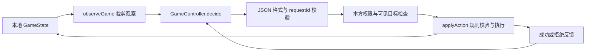

# 大模型操控者：协议与 DeepSeek 接入

当前已实现服务商无关的观察、指令校验和异步执行器，并接通 DeepSeek 本地代理及页面「模型操控」入口。算法 AI 仍可独立使用。模型凭证由 Node 代理读取，浏览器只提交裁剪后的观察；配置和真实调用记录见 [DeepSeek 本地接入](deepseek-local.md)。

建议先采用**每次一个动作、执行后重新观察**的方式接入。它直接复用现有 `Action` 和 `applyAction`，便于确认模型究竟做了什么，以及错误发生在哪一步。连续移动、攻击会改变位置、视野、金币与产能，因此不让模型一次提交整回合动作列表。

## 1. 接口位置



| 文件 | 责任 |
|---|---|
| `src/controllers/observation.ts` | 构造允许交给外部操控者的观察数据 |
| `src/controllers/protocol.ts` | 协议类型、回复 JSON Schema、严格解析器 |
| `src/controllers/instructions.ts` | 服务商无关的控制指令模板 |
| `src/app/controller-turn.ts` | 超时、取消、重试、限额、规则执行与可选算法兜底 |
| `scripts/demo-controller.ts` | 完全离线的完整调用示例与示例文件生成器 |

后续每个服务商只需要实现这个接口：

```ts
interface GameController {
  id: string;
  decide(request: ControllerRequest, signal: AbortSignal): Promise<unknown>;
}
```

适配器负责把请求发送到所选模型，并把返回的单条指令交回执行器。执行器不依赖模型名称、聊天消息格式或服务商专有的工具调用格式。返回值用 `unknown`，是为了强制经过运行时校验，而非相信 TypeScript 类型断言。

## 2. 模型能看到什么

`observeGame` 按字段白名单重新构建对象，不能用 `JSON.stringify(playerView.state)` 代替。

| 数据 | v1 处理 |
|---|---|
| 棋盘地形、所有城市及其归属/等级/耐久 | 公开 |
| 己方单位与货舱、金币、产能、生产计划 | 公开给当前操控方 |
| 敌方单位 | 仅当前实际可见的单位；不公开货舱内容 |
| 本方过去见过的敌军 | `ghosts` 中记录旧位置和 `seenAt`，不当作当前目标 |
| 本局兵种、能力、扩展说明、地形参数与实际生产费用 | 公开规则 |
| 敌方金币、计划、记忆、隐藏单位、完整日志、随机种子 | 不发送 |
| 存档中的未知附加字段 | 不发送 |

坐标从 0 开始，地图数组按行排列，格索引为 `y * width + x`。`turn` 是单方行动序号，`round` 是双方各行动一次的完整轮。

指挥官 `self.orders: null` 表示没有显式计划，可以自主生产；`[]` 或空队首表示本回合不招募、不升级。`self.production` 是规则内核保存的消费，控制器不能通过重新请求恢复额度。

关闭迷雾会公开全部单位位置，但仍不公开敌方私有字段。观察只能为当前行动方生成，执行器不会让模型选择另一位玩家或更改当前方。

## 3. 请求与回复

请求包含协议版本、当前请求标识、观察、权限/剩余请求数，以及上一动作的简短反馈。完整可运行示例见 [请求 JSON](examples/controller-request.json)。

回复形状如下；实际 `requestId` 必须原样使用本次请求值：

```json
{
  "protocolVersion": 1,
  "requestId": "controller-1:A:1:1",
  "action": {
    "type": "RECRUIT",
    "cityId": "c1",
    "unitType": "militia"
  },
  "explanation": "补充一支民兵。"
}
```

支持 `MOVE`、`ATTACK`、`SIEGE`、`RECRUIT`、`BUILD`、`LOAD`、`UNLOAD`、`UPGRADE`、`SET_ORDERS`、`END_TURN`。招募来源在 `cityId` 和军营 `unitId` 中二选一。

回复只接受一个 JSON 对象或其纯 JSON 字符串，不接受 Markdown 围栏、动作数组、未知字段或整份状态。协议限定标识符最多 128 个 Unicode 码点、解释最多 500 个码点、回复最多 16 KiB，生产队列最多 5 格。棋盘边界、金币、占位、时代、编制及生产额度仍由规则内核校验。

16 KiB 是解析器执行的 UTF-8 字节限制，不是 JSON Schema 的字段长度关键字；服务商支持 Schema 也不能代替本地解析器。

`requestId` 防止上一请求的有效答案被重放到下一步；本地执行器还检查状态对象是否已被替换。因此同一方、同一回合重新导入存档，也不会应用旧响应。它不把请求标识当作联机身份认证。

`explanation` 仅用于展示操作目的，不执行其中的命令，也不要求模型给出长篇推理。将来展示时应使用 `textContent` 或转义；兵种名称和描述也始终作为数据处理。

参考文件：[回复 JSON](examples/controller-response.json)、[回复 Schema](examples/controller-reply.schema.json)、[指令模板](examples/controller-instructions.txt)、[拒绝反馈](examples/controller-feedback.json)。

## 4. 执行、权限和失败处理

`executeControllerTurn(context, controller, options)` 只驱动当前方。成功动作立即保存、渲染，然后重新观察；模型必须明确提交 `END_TURN` 才正常交接回合。模型不能修改状态、切换玩家、直接指定胜者或跳过产能。

| 选项 | 默认值 | 行为 |
|---|---|---|
| `maxRequests` | 12 | 当前执行批次的模型决策上限，可设 1–50 |
| `timeoutMs` | 15000 | 单次请求超时，可设 1–120000 毫秒 |
| `maxRequestBytes` | 131072 | UTF-8 JSON 请求上限，可设至 1 MiB；不等同于 token 上限 |
| `maxConsecutiveRejections` | 2 | 连续无效回复达到阈值后停止 |
| `allowOrderEdits` | false | 默认保护人类指挥官队列；设 true 才允许 `SET_ORDERS` |
| `failurePolicy` | `stop` | 默认暂停；显式设 `algorithm` 才将剩余回合交给算法 AI |
| `signal` | 无 | 调用方通过 `AbortController` 即时取消等待 |

`controls.remainingRequests` 会告诉模型还剩几次机会，包含当前请求。限额或超时发生时，默认保留已执行的合法动作和当前回合，等待人类接管或重新发起一批请求，不额外扣钱、不自动结束回合。

格式或规则错误会收到固定简短反馈，模型可以在限额内改正。不可见目标和不存在目标得到相同的不可观察反馈，不用错误提示泄露隐藏实体。提供方原始异常或畸形回复不会写入反馈或游戏日志。

取消、换局和过期响应始终停止，不触发算法兜底。即使提供方忽略取消信号，超时竞争仍会使本地结束等待，迟到的结果不能再次执行。接入页面时，暂停、重新开局、导入存档、离开房间都应调用 `abort()`，同时更新应用自己的有效任务标记。

最小调用形式：

```ts
const cancellation = new AbortController();
const result = await executeControllerTurn(context, controller, {
  signal: cancellation.signal,
  maxRequests: 12,
  timeoutMs: 15000,
  failurePolicy: 'stop',
});
```

`context` 与现有 AI 回合一样提供 `getState/setState/active/save/render/sleep`，并可通过 `onEvent` 展示请求中、成功、拒绝和停止状态。状态更新应使用规则返回的新对象。每个对局只运行一个操控任务；新任务开始前取消旧任务。

返回状态区分 `turn-ended`、`game-over`、`cancelled`、`stale-state`、请求限额、请求体过大、无效回复、超时与提供方故障。`appliedActions` 只统计模型提出并成功执行的动作；算法兜底另由 `fallbackUsed` 标记。

## 5. 本地试跑

```bash
npm run demo:controller
npm run test:controller
npm run demo:controller -- --write-examples
```

演示用固定种子和脚本控制器完成：

1. 招募一支民兵，成功消耗一份产能。
2. 故意重复招募，被规则拒绝，没有重复扣钱。
3. 收到反馈后提交 `END_TURN`，轮到 B。

示例生成命令重建本目录下的 JSON、Schema、指令文本及 [演示结果](examples/controller-demo-result.json)，无需密钥。脚本控制器不是大模型，此演示不检验推理能力。

本次验证包含原有 366 项回归和新增 44 项控制器测试，全部通过；类型检查、生产构建和离线演示通过。新增用例覆盖隐藏信息与未知字段隔离、协议形状、重放、产能、过期响应、取消、超时、请求限额及算法兜底期间换局。

## 6. 真实模型与后续扩展

已提供 `createLocalModelController()` 和 `server/model-proxy.ts`，默认连接 DeepSeek；新增服务商仍只需实现 `GameController`。密钥由本地代理或服务端持有，浏览器只调用该代理；不放入前端环境变量、GameState 或对局导出文件。

适配器应将观察与指令模板转换为所选 API 的输入，把模型输出或工具参数转换成这份回复协议，并传递取消信号。单独处理服务商错误、限流和 token/费用预算，不允许网络层无限重试。

页面顶栏「模型操控」执行当前方的一回合，展示进度并可暂停接管。打开面板会暂停现有算法任务；模型结束、失败或达到限额后仍保持暂停，不自动启动下一方。指挥官计划由人类保留，模型不能改写。当前模型入口仅用于本地对局，联机房间禁用。

v1 每次带完整公开规则和局面，方便审计但输入较大。后续可评估缓存静态规则、压缩地形和分层策略；暂不随意裁剪可见兵力或截断计划，以免改变模型获得的信息。真实 API 已完成三次决策的格式与规则联调；费用评估、棋力与长局表现尚未验证，也不包含服务端防作弊。

## 7. 已有 DeepSeek 测试凭证

用户于 2026-10-25 指定后续测试复用其他项目保存的 DeepSeek 凭证。已通过历史聊天《重新测试完整流程并加入跳过》定位到当前 Windows 用户加密的 DPAPI 凭证文件。现已通过本机代理成功调用三次真实决策，没有输出或复制明文密钥。

本机被 Git 忽略的 `.env.local` 使用 `DEEPSEEK_CREDENTIAL_FILE` 记录原文件路径。DeepSeek 本地代理优先读取环境变量 `DEEPSEEK_API_KEY`，没有时由当前 Windows 用户解密该文件。不要添加 `VITE_` 前缀，也不要将密钥放进观察数据、前端构建或存档。普通游戏和离线测试不会自动调用真实 API。
